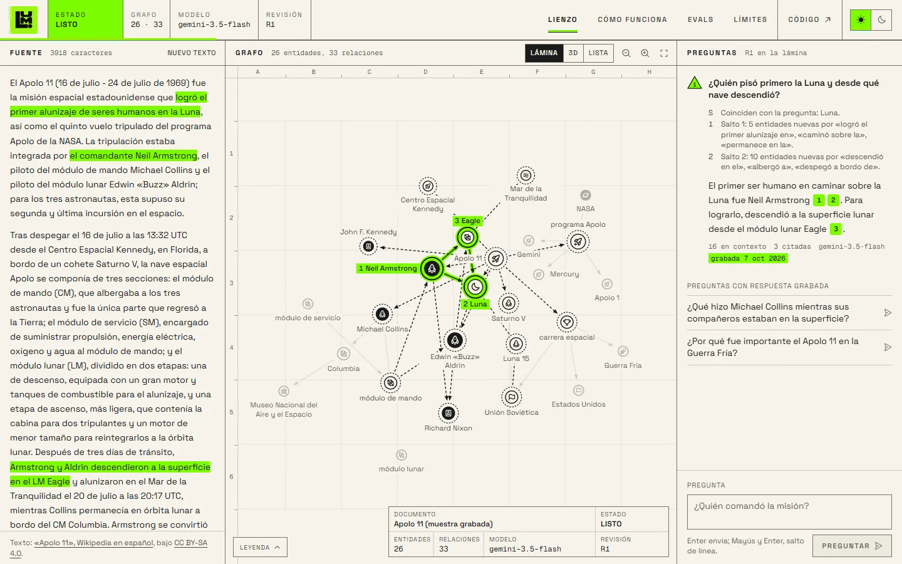
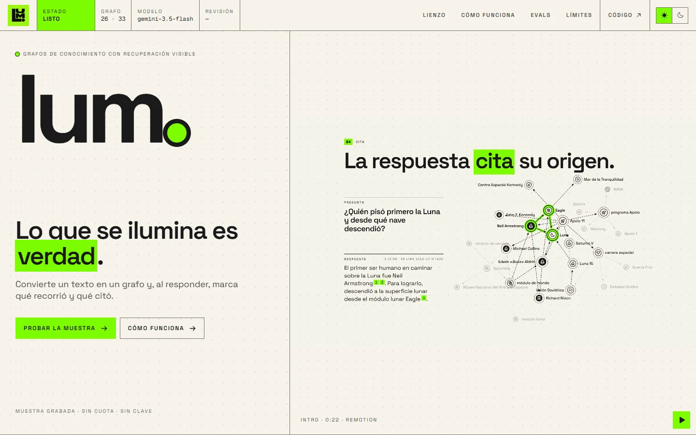
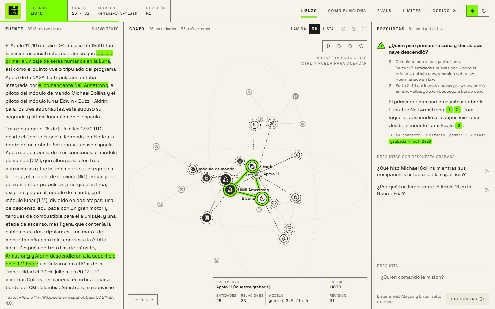
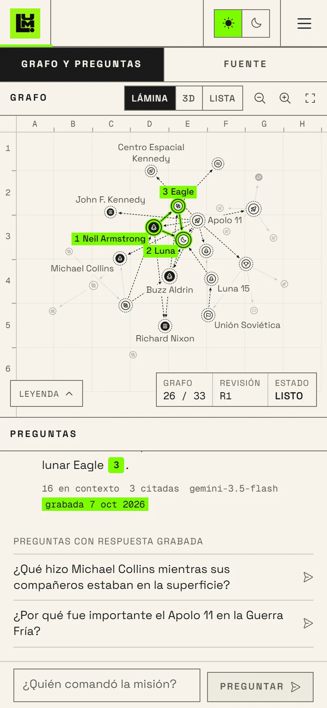
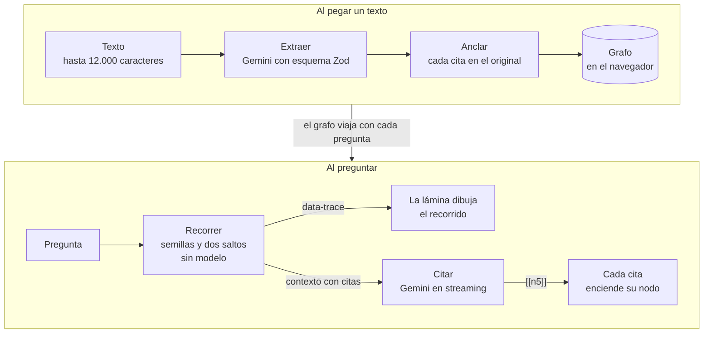
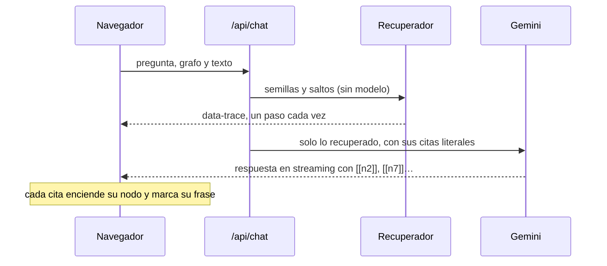

<div align="center">


# LUM

**Convierte un texto en un grafo de conocimiento y, al responder, enseña qué recorrió y qué citó.**

Lo que se ilumina no es decoración: es el recorrido real del recuperador y las citas reales del modelo.

[](https://github.com/Adriiiii24/LUM/actions/workflows/ci.yml)


[Qué es](#qué-es) · [Cómo funciona](#cómo-funciona) · [Probarlo en local](#probarlo-en-local) · [Evals](#evals) · [Arquitectura](docs/ARCHITECTURE.md)

</div>

<br>

<picture>
  <source media="(prefers-color-scheme: dark)" srcset="docs/media/demo-oscuro.gif">
  
</picture>

<sub>El vídeo de la portada (22 s). Todo lo que enseña sale de la muestra grabada: el texto, el grafo, el recorrido real de la primera pregunta y la respuesta con sus citas.</sub>

## Qué es

LUM convierte un texto pegado en un grafo de entidades y relaciones, y responde preguntas sobre él. Mientras responde, marca en el propio grafo por dónde ha buscado y en qué se apoya cada frase de la respuesta. Cada nodo remite a la frase del texto de la que salió, y la calidad de la extracción se mide con un banco de evals en Python.

| Necesidad | Problema que hoy existe | Qué aporta LUM |
|---|---|---|
| Entender un texto largo sin leerlo entero | Un resumen o una búsqueda por palabras pierde la estructura: quién es quién y quién hizo qué | Convierte el texto en entidades y relaciones; cada una remite a la frase original |
| Preguntar a un documento con trazabilidad | Los chatbots sobre documentos (RAG) responden sin mostrar qué fragmentos usaron | Muestra el recorrido real de la búsqueda, salto a salto, y solo marca lo que la respuesta cita |
| Confiar en una extracción hecha por IA | Un modelo puede inventar entidades o citas sin que nadie lo note | Ancla cada cita al texto (lo que no aparece queda «sin anclaje») y mide la calidad frente a textos anotados a mano |
| Ver cómo llega la IA a su respuesta | Muchas demos enseñan el resultado y esconden el mecanismo | Lo que se ilumina es el recorrido del algoritmo y las citas del modelo, no un efecto visual |
| Probarlo sin cuenta ni coste | Muchas herramientas exigen pago o suben el texto a servicios ajenos | Capa gratuita de Gemini; el grafo vive en el navegador y el servidor no guarda textos |

## Así se ve

<picture>
  <source media="(prefers-color-scheme: dark)" srcset="docs/media/lienzo-oscuro.webp">
  
</picture>

<sub>La pregunta «¿Quién pisó primero la Luna y desde qué nave descendió?» sobre la muestra. A la derecha, el recorrido (semillas y dos saltos) y la respuesta con sus notas 1, 2 y 3; en el centro, esos tres nodos encendidos; a la izquierda, sus frases de origen marcadas.</sub>

<details>
<summary><b>Más capturas:</b> portada, vista 3D y móvil</summary>
<br>

<picture>
  <source media="(prefers-color-scheme: dark)" srcset="docs/media/portada-oscuro.webp">
  
</picture>

<table>
  <tr>
    <td width="68%"></td>
    <td width="32%"></td>
  </tr>
  <tr>
    <td><sub>Vista 3D: el mismo grafo y los mismos estados, en un espacio que se gira.</sub></td>
    <td><sub>En móvil, el grafo y las preguntas a la vez.</sub></td>
  </tr>
</table>

</details>

## Cómo funciona



1. **Extraer.** `generateText` del AI SDK 7 con `Output.object` y un esquema plano ([`lib/graph/schema.ts`](lib/graph/schema.ts)). Gemini devuelve entidades y relaciones, cada una con una cita literal del texto.
2. **Anclar.** Cada cita se busca en el original, tolerando espacios, saltos de línea y comillas ([`lib/graph/normalize.ts`](lib/graph/normalize.ts)). La que no aparece queda marcada «sin anclaje».
3. **Recorrer.** Semillas por coincidencia de nombres con la pregunta y expansión en anchura de hasta dos saltos, ordenada por cuánto toca cada arista la intención de la pregunta ([`lib/graph/retrieve.ts`](lib/graph/retrieve.ts)). Es determinista y no usa ningún modelo.
4. **Citar.** El modelo responde solo con lo recuperado y cita ids de entidad. Cada cita se convierte en una nota que enciende su nodo mientras se escribe ([`lib/chat/citations.ts`](lib/chat/citations.ts)).

### Una pregunta, paso a paso

El recorrido sale antes que el texto: la lámina lo dibuja mientras llega el primer token.



## El lienzo

- **Tres vistas del mismo grafo.** La lámina 2D (React Flow), una vista **3D** que se gira arrastrando o con las flechas y una lista accesible. El recorrido y las citas se encienden igual en las tres. El layout 3D es de fuerzas, determinista ([`lib/graph/layout3d.ts`](lib/graph/layout3d.ts)), con proyección propia en SVG y sin WebGL.
- **Iconos que salen del texto.** Cada entidad lleva el icono de lo que el texto dice que es: un cohete, la Luna, un país, un presidente. Son reglas de palabras sobre el nombre y la cabeza de la descripción, sin modelo ([`lib/graph/icons.ts`](lib/graph/icons.ts)). Si no hay pista, el icono de su tipo.
- **Foco legible.** Al pasar por un nodo, se aparta todo lo que no es su vecindario y la ficha lista sus relaciones. Pasar por encima nunca enciende nada en lima: la lima es solo para lo recorrido y lo citado.
- **Accesible.** Se recorre con el teclado (Tab y flechas), la lista es la alternativa no visual de la lámina y, con movimiento reducido, el recorrido aparece de golpe y el scroll deja de ser suave.

## Decisiones técnicas

| Decisión | Por qué |
|---|---|
| **Una llamada a Gemini por pregunta**, sin agente con herramientas | La recuperación es un algoritmo, así que lo que se ve es comprobable. |
| **Modelo con reserva**: `gemini-3.5-flash` y, ante 503 o 429, `gemini-3.5-flash-lite` | La reserva tiene cuota gratuita propia. Una respuesta nunca mezcla modelos. |
| **Sin `maxItems` en el esquema** | Con valores altos, Gemini responde 400. Los límites (60 entidades, 120 relaciones) van en el prompt y los aplica la normalización. |
| **Grafo en el navegador** | El servidor no guarda nada. Neo4j AuraDB Free se descartó porque se pausa a las 72 horas sin consultas. |
| **La demo nunca está rota** | La portada usa una muestra grabada de llamadas reales ([`data/sample/sample.json`](data/sample/sample.json)), reproducida por el mismo camino que una respuesta en vivo y etiquetada como grabada. |

<details>
<summary><b>Stack completo</b></summary>
<br>

| Capa | Tecnología |
|---|---|
| Web | Next.js 16 (App Router, Cache Components), React 19, TypeScript estricto |
| Estilo y movimiento | Tailwind CSS 4, Motion, Lenis (scroll suave) |
| Grafo | React Flow 12, d3-force, proyección 3D propia en SVG |
| IA | AI SDK 7, Gemini (capa gratuita), Zod 4 |
| Estado | Zustand, un almacén por visita |
| Evals | Python con `uv`, Pydantic, `rapidfuzz`, pytest |
| Vídeo | Remotion |
| CI | GitHub Actions: lint, tipos, tests, build y evals |

</details>

## Probarlo en local

Hace falta **Node 24.11** o posterior y una clave de la API de Gemini (la capa gratuita basta).

```sh
npm install
cp .env.example .env.local   # pon tu clave en GOOGLE_GENERATIVE_AI_API_KEY
npm run dev
```

La muestra funciona sin clave: sus respuestas están grabadas y no gastan cuota. La clave solo hace falta para extraer textos propios o hacer preguntas nuevas.

<details>
<summary><b>Variables de entorno</b></summary>
<br>

| Variable | Para qué |
|---|---|
| `GOOGLE_GENERATIVE_AI_API_KEY` | Clave de Gemini. Solo la usa el servidor. |
| `NC_EXTRACT_MODEL`, `NC_CHAT_MODEL` | Modelo principal de cada tarea (`gemini-3.5-flash`). |
| `NC_EXTRACT_FALLBACK_MODEL`, `NC_CHAT_FALLBACK_MODEL` | Modelo de reserva (`gemini-3.5-flash-lite`). |
| `NC_EXTRACT_THINKING` | Razonamiento de la extracción: `low` o `medium` (por defecto). |
| `NC_EXTRACT_PER_HOUR`, `NC_CHAT_PER_HOUR` | Límite aproximado por IP y por instancia (8 y 40). |

</details>

<details>
<summary><b>Comandos</b></summary>
<br>

| Comando | Qué hace |
|---|---|
| `npm test` | Pruebas de normalización, recuperación, iconos, layout y citas (`node --test`). |
| `npm run typecheck`, `npm run lint`, `npm run build` | Tipos estrictos, ESLint y compilación de producción. |
| `npm run record:sample` | Regraba la muestra con llamadas reales. Necesita la app en marcha y `BASE_URL`. |
| `npm run sample:relayout` | Recalcula solo el layout de la muestra, sin llamar a la API. |
| `npm run evals:export` | Graba ejecuciones del pipeline sobre los textos de referencia. |

</details>

## Evals

En [`evals/`](evals/README.md) hay un proyecto en Python, gestionado con `uv`. Compara la extracción con textos anotados a mano y mide:

- precisión, exhaustividad y F1 de entidades y relaciones;
- exactitud de tipo;
- anclaje de citas y validez del esquema.

Puntúa ejecuciones grabadas, así que corre en CI sin llamar al modelo:

```sh
cd evals
uv run pytest -q
uv run nc-evals score --check
```

> [!NOTE]
> La web solo publica resultados cuando los textos de referencia están revisados por una persona. Los tres actuales son borradores, así que todavía no hay cifras publicadas.

## Vídeo de introducción

La portada abre con un vídeo hecho con [Remotion](https://www.remotion.dev/) en [`video/`](video/), un proyecto aparte con su propio `package.json`. Hay un render por tema (claro y oscuro) en `public/video/`.

<details>
<summary><b>Renderizarlo</b></summary>
<br>

```sh
cd video
npm install
npm run studio   # editar y previsualizar
npm run build    # mp4, webm y póster de los dos temas
```

Si cambia la muestra (`npm run record:sample`), hay que volver a renderizar el vídeo.

Los renders llevan `--color-space=bt709` (rango de color estándar). Sin esa opción, Remotion sacaba el vídeo en rango completo, y Chrome y Edge no podían decodificar el WebM: la portada se quedaba en el primer fotograma. La web ofrece primero el MP4 por la misma razón.

</details>

<details>
<summary><b>Estructura del repositorio</b></summary>
<br>

```
app/            página, estilos, icono y las rutas /api/extract y /api/chat
components/     site (portada, cabecera, pie), canvas (lámina, 3D, lista), chat, source, explain
lib/            graph (esquema, normalización, recuperación, layouts, iconos), ai, chat, state, server
data/sample/    la muestra grabada (texto del Apolo 11, grafo y respuestas)
evals/          banco de evals en Python
video/          vídeo de introducción en Remotion
docs/           arquitectura e imágenes de este README
```

Más detalle en [`docs/ARCHITECTURE.md`](docs/ARCHITECTURE.md). El producto y sus principios, en [`PRODUCT.md`](PRODUCT.md); el sistema de diseño, en [`DESIGN.md`](DESIGN.md).

</details>

## Límites

- La capa gratuita de Gemini tiene cuotas no publicadas, y Google puede usar lo que se le envía para mejorar sus productos. La interfaz lo avisa.
- Hasta 12.000 caracteres por texto. Los textos largos todavía no se trocean.
- Las semillas salen de coincidencias de palabras, no de embeddings: una pregunta con sinónimos puede no encontrar su entidad.
- No es el GraphRAG de Microsoft: no detecta comunidades ni escribe resúmenes jerárquicos.

## Créditos y licencias

- El rediseño del 2026-10-13 partió de la estructura de [mijobello.com](https://mijobello.com/) (rejilla de 12 columnas, cabecera fija, vídeo en la portada y pie a sangre). Los motivos son de LUM: el lienzo de puntos, el rotulador lima de los titulares, las cabeceras con índice, el pipeline de nodos y el punto de la marca como nodo citado. No se ha copiado ningún texto, imagen ni vídeo de esa web.
- El texto de la muestra es la introducción de «Apolo 11» de la Wikipedia en español, bajo CC BY-SA 4.0. Ver [`data/sample/ATTRIBUTION.md`](data/sample/ATTRIBUTION.md).
- Los textos de `evals/gold/` son originales, escritos para este banco.
- Licencia del código: por decidir.

<br>

<div align="center">
<sub>Hecho por <a href="https://github.com/Adriiiii24">Adrián Martínez Panés</a>.</sub>
</div>
